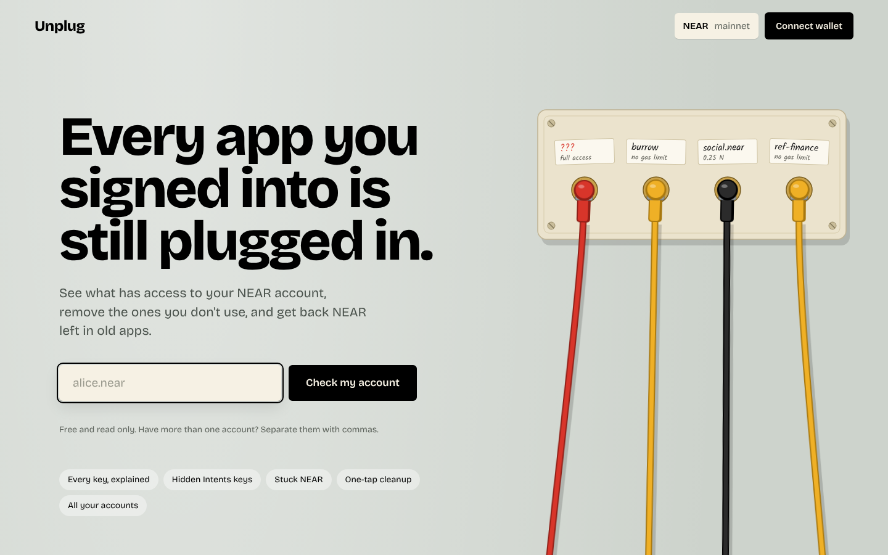
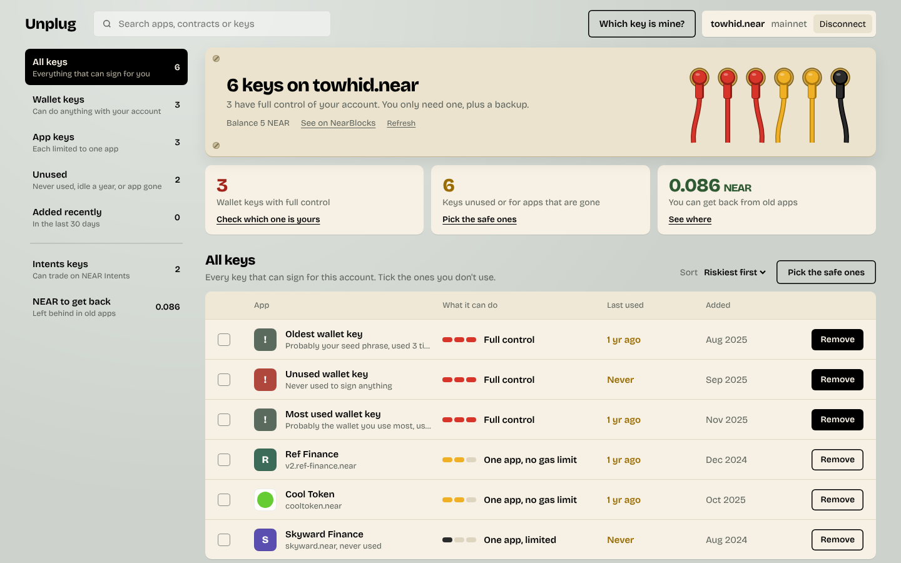
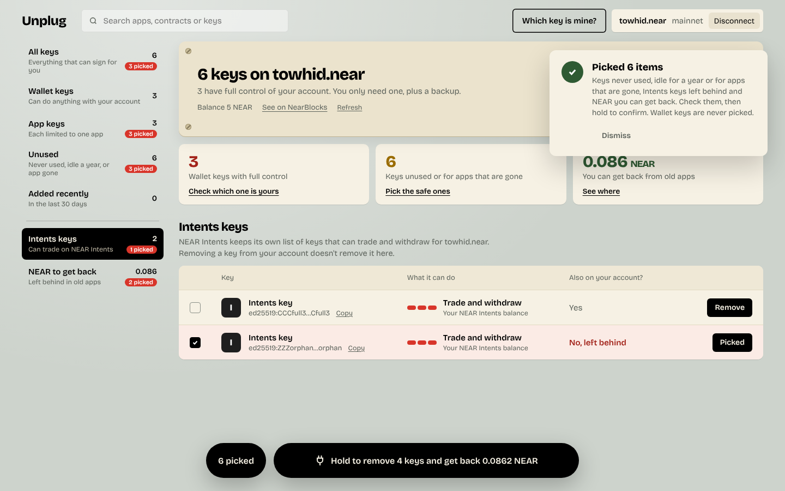
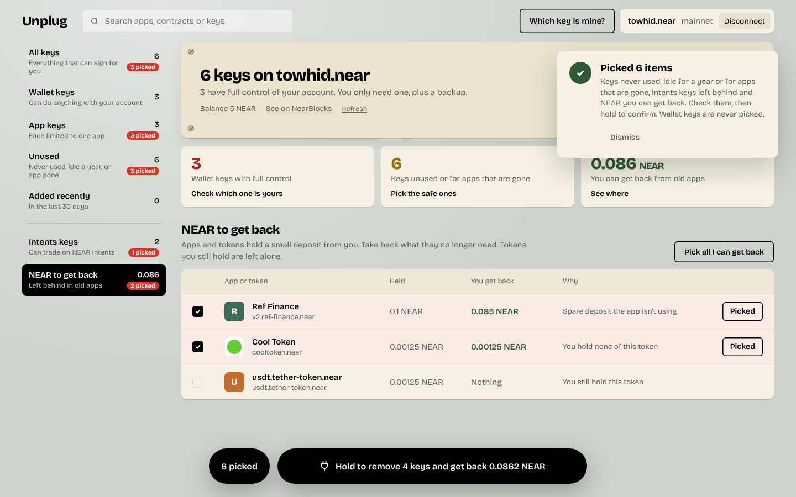
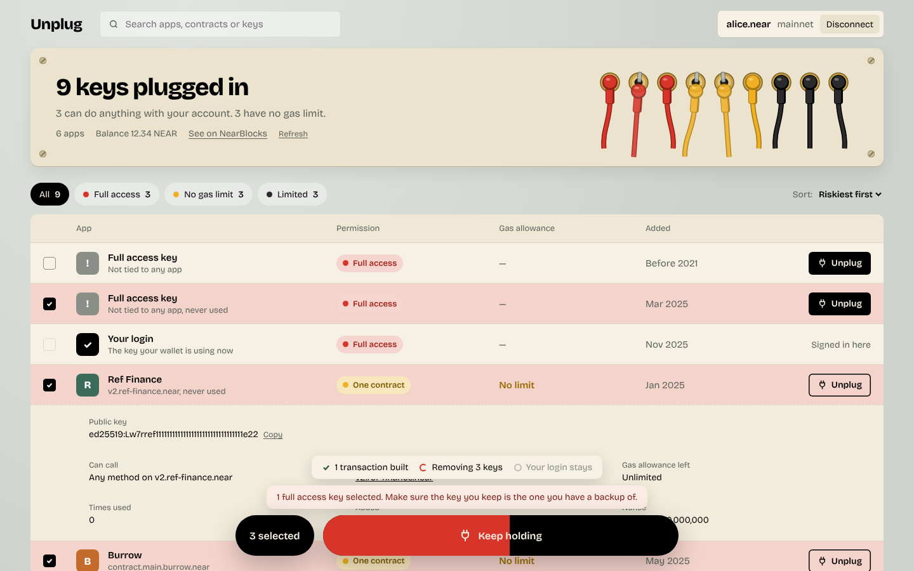
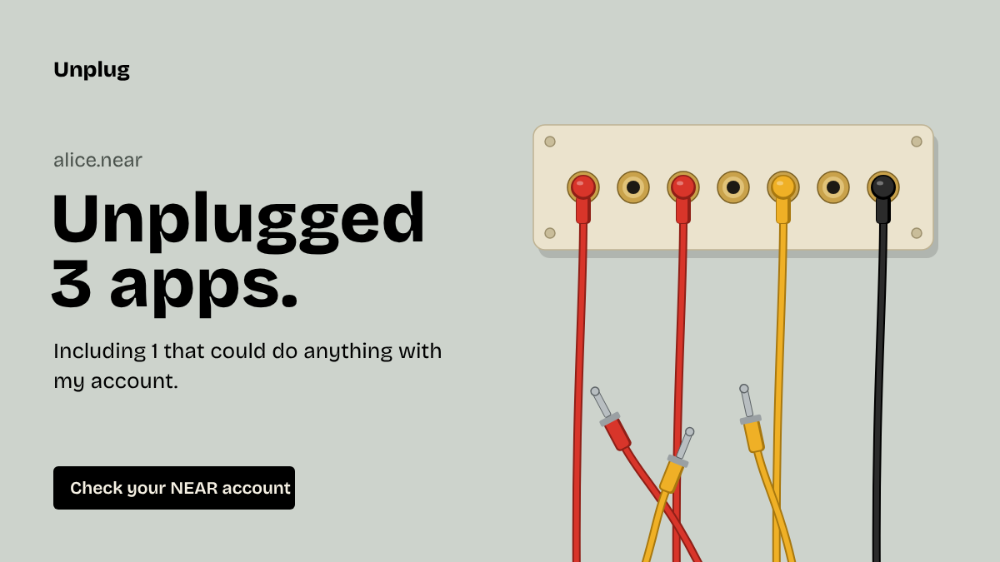
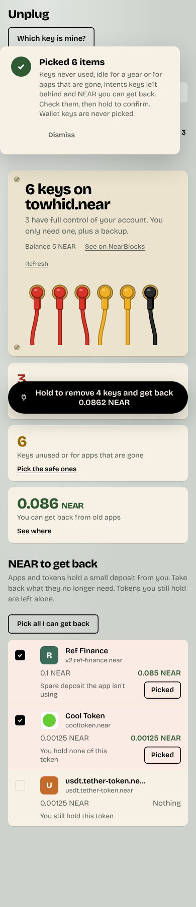

# Unplug

**See every app plugged into your NEAR account, and unplug the ones you don't use.**

Live demo: `https://YOUR-PROJECT.vercel.app` *(replace after deploying)*



The landing page walks through every feature with a short animated demo of each ([full page](docs/landing-full.png)).

---

## Try it in 30 seconds

1. Open the site and type any NEAR account, like `root.near`. No wallet needed.
2. Browse the sidebar: **Wallet keys**, **App keys**, **Unused**, **Added recently**, **Intents keys**, **NEAR to get back**.
3. Press **Pick the safe ones** to see what Unplug would clean up.
4. To actually remove keys, open your own account, slide to connect your wallet and hold.

## The problem

Every time you sign into a NEAR app, a new access key is added to your account. Nobody removes them.

After a year on NEAR, a normal account has a pile of forgotten keys:

- **Function call keys** for apps you used once, some with **no gas limit**, some for contracts that **no longer exist**.
- **Wallet keys (full access)** from old wallets, old devices or old browser sessions. Any one of them can send all your tokens, add new keys or delete the account.

Every leftover key is a door into the account. If any of those apps or devices is ever compromised, the key still works. NEAR wallets show little or none of this, and there's no simple tool like revoke.cash for NEAR access keys.

## The solution

Unplug lists every key on a NEAR account, explains in plain words what each one can do, and removes the ones you choose in **one transaction**. It also finds the NEAR Intents keys nobody can see, and the NEAR you've left behind in old apps.

**What it does**

- **Account keys:** every access key, its power, its app, when it was added and **when it was last used**.
- **NEAR Intents keys:** the separate key list on `intents.near` that can sign trades and withdrawals for you, with keys left behind after you removed them from your account flagged.
- **Stuck NEAR:** storage deposits held by apps and tokens you no longer need, with a one-hold refund.
- **Pick the safe ones:** one tap selects never used keys, keys for dead apps, keys idle for over a year, left-behind Intents keys and refundable deposits. It never picks a wallet key.
- **Several accounts at once:** type `a.near, b.near` to see all of them side by side.







### What it shows for every key

All of it is read straight from NEAR RPC. There is no backend, no indexer and no database.

| Detail | How it's found |
|---|---|
| Full access or limited to one contract | `view_access_key_list` permission field |
| Which app the key belongs to | Receiver contract, matched against known NEAR apps |
| Which methods it can call | `method_names` on the key |
| Gas allowance left, or unlimited | `allowance` on the key |
| Whether the app's contract still exists | `view_account` on the receiver: live, no contract, or deleted |
| When the key was added | The key's nonce starts at `block height × 1,000,000`; that block is dated with an archival node |
| How many times it was used | Current nonce minus the starting nonce, with **never used** flagged |
| When it was last used | Binary search over archival `view_access_key` history for the block where the nonce last changed |
| Public key, nonce and block | Shown in full, linked to NearBlocks |

Keys are sorted into plain categories in the sidebar:
- **Wallet keys:** can do anything with the account (with a split into *This wallet* and *Other wallets* once you check which key your wallet uses)
- **App keys:** each limited to one app
- **Unused:** never used, idle for a year, or for an app that no longer exists
- **Added recently:** keys added in the last 30 days, to spot anything you don't recognise
- **Intents keys** and **NEAR to get back**

Each key shows an access meter: 3 bars for full control, 2 for one app with no gas limit, 1 for one app with a limit.

## NEAR Intents keys

`intents.near` keeps its own list of public keys allowed to sign intents for each account (`public_keys_of`). These are separate from account keys, and removing a key from your account does **not** remove it from Intents. Unplug lists them, marks the ones that are no longer on your account, and removes them with `remove_public_key` (1 yoctoNEAR deposit, as the contract requires).

## Stuck NEAR

Every token and many apps hold a NEP-145 storage deposit for your account. Unplug finds your tokens (FastNEAR API) plus the apps behind your keys, reads `storage_balance_of` and `ft_balance_of`, and offers:
- `storage_withdraw` for any spare deposit the app isn't using, and
- `storage_unregister` (`force: false`) for tokens you hold none of, which returns the whole deposit.

Tokens you still hold are never touched, and `force: false` makes the contract refuse if anything is left.

## How unplugging works

1. **Look up any account.** Anyone can type an account and see what's plugged in. It's read only, with no wallet needed.
2. **Select** the keys to remove (or press **Remove** on a single row).
3. **Slide to connect** the wallet that owns the account.
4. **Hold for about 2 seconds** to confirm. While you hold, the selected plugs pull out of the switchboard in the header and a checklist shows what's about to happen. Letting go cancels.
5. The wallet opens with as few transactions as possible: one `DeleteKey` batch on your account, one `remove_public_key` batch on `intents.near`, and one refund call per app.
6. A **share card** is generated for X.





## Safety

- **Read only by default.** Nothing can change without the owner's wallet signing.
- **Connecting never adds a key.** The wallet selector is set up without a contract, so signing in doesn't plug in yet another key.
- **The wallet you use is protected.** Once you press *Which key is mine?* (a free, gasless signature), that key is marked and can't be selected.
- **The last wallet key can never be removed**, so the account can't be locked forever by mistake.
- **Clear warnings** when a wallet key is selected.
- **Pick the safe ones never selects a wallet key.** Those are always a manual choice.
- **Two deliberate gestures** (slide, then hold), plus the wallet's own confirmation, so nothing happens by accident.
- **Wrong account check.** If the connected wallet isn't the account being viewed, Unplug asks you to switch instead of failing.

## NEAR tech used

- **NEAR RPC:** `view_access_key_list`, `view_account`, `block` and `call_function`, with fallback across FastNEAR and NEAR RPC endpoints
- **NEAR Intents:** `public_keys_of` and `remove_public_key` on `intents.near`
- **NEP-145 storage management:** `storage_balance_of`, `storage_withdraw`, `storage_unregister`
- **FastNEAR API:** list of tokens the account holds
- **NEP-413 message signing:** a free, gasless signature that shows which key the connected wallet uses
- **Archival RPC:** dates each key's creation block and finds when each key was last used
- **NEAR Wallet Selector:** MyNearWallet, Meteor, HERE and Intear
- **`DeleteKey` actions** batched into a single transaction
- **Mainnet and testnet:** add `?network=testnet` to the URL

## Run it locally

Requires Node.js 18 or newer.

```bash
npm install
npm run dev       # opens http://localhost:5173
npm run build     # static site in dist/
```

## Deploy

It's a static Vite site.

1. Push this repo to GitHub.
2. On [vercel.com](https://vercel.com), choose **Add New → Project** and import the repo.
3. Keep the defaults: framework **Vite**, build `npm run build`, output `dist`.
4. Deploy.

## Project structure

```
index.html          page shell
src/main.js         landing page, sidebar categories, key list, Intents and storage views,
                    selection, slide and hold, share flow, multi-account view
src/near.js         all NEAR reads: keys, accounts, block dates, last used,
                    Intents keys, storage deposits, token logos
src/wallet.js       wallet selector, key check (NEP-413) and the batched transactions
src/apps.js         friendly names for known NEAR contracts
src/share.js        draws the 1200×675 share card on a canvas
src/style.css       all styles
docs/               screenshots for this README
```

## Roadmap

- Telegram alerts when a new key is added to your account
- Who added each key (needs an indexer, not available from RPC alone)

## Mobile

The whole app works on phones: the table turns into stacked rows and the slide and hold bar stays at the bottom of the screen.



---

Built for the NEAR Hackathon 2026.
